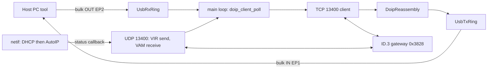

# DoIP Tester over a USB Bridge for the STM32 lwIP Firmware

## 1. Protocols in the captures (IPv6 excluded)

Between them, the two captures contain these protocols:

- **Ethernet II.** Untagged frames, no VLAN. The gateway MAC is `9c:28:bf:d6:92:0c` (an AUMOVIO/Continental part). The tester is `c4:e9:84:d7:ae:17`.
- **ARP, including RFC 5227 probe and announcement.** The gateway sends an ARP Probe (sender IP 0.0.0.0), then an ARP Announcement. It also answers normal ARP requests from the tester.
- **IPv4, including IPv4 link-local addressing (AutoIP, RFC 3927).** There is no DHCP server on the link. After about 15 s of unanswered DHCP Discovers, both sides fall back to `169.254.x.x` addresses: the gateway used `169.254.198.14` in one capture and `169.254.52.195` in the other, and the tester used `169.254.52.195`. Traffic uses limited broadcast `255.255.255.255`.
- **UDP**, carrying DHCP and DoIP.
- **DHCP client (BOOTP, port 68 to port 67).** Both the tester and the gateway send only Discovers. The gateway requests only option 1 (subnet mask) and option 3 (router). Nothing on the link is a DHCP server, and none is needed.
- **TCP.** The tester connects from an ephemeral port to gateway port 13400. The gateway advertises MSS 1460 only, with no window scaling, SACK, or timestamps.
- **DoIP (ISO 13400-2:2012, protocol version `0x02`, inverse `0xFD`).** Messages seen:
  - `0x0004` Vehicle Announcement: UDP from port 13400 to `255.255.255.255:13400`, sent 3 times at 500 ms intervals about 50 ms after the gateway's ARP announcement. It carries VIN `WVWZZZE1ZMP002689`, logical address `0x3828`, EID and GID `9c28bfd6920c`, and further-action code `0x00`.
  - `0x0005` Routing Activation Request: source address `0x0E89`, type `0x00` (default).
  - `0x0006` Routing Activation Response: code `0x10` (success), received after about 300 ms.
  - `0x8001` Diagnostic Message, and `0x8002` Diagnostic Message positive ACK.
  - The tester never sent a `0x0001` Vehicle Identification Request. It relied on the gateway's announcements.
- **UDS (ISO 14229), carried inside DoIP diagnostic messages.** The only exchange was `0x22` ReadDataByIdentifier for DID `0xF17C` (VW FAZIT ID). The response was the ASCII string `SJ8-ICS03.08.2011750150`.

The gateway also runs DoIP over IPv6 (link-local announcements to `ff02::1`, plus DHCPv6, MLD, and ND), but this plan leaves IPv6 out as you asked.

## 2. What the stack on `main` is missing

The analysis uses the `main` branch, which is lwIP 2.1.2 with `NO_SYS=1` and the raw API. The working tree is now clean; the earlier IPv6 edits appear to live on `feat/ipv6`.

Already present and enabled: Ethernet, ARP, IPv4, ICMP, UDP, TCP, and the DHCP client.

Missing:

- **AutoIP.** `middlewares/lwip/src/core/ipv4/autoip.c` is already compiled by the glob, but `LWIP_AUTOIP` defaults to 0 and `LWIP_DHCP_AUTOIP_COOP` is off. Without AutoIP the board can never join the car's `169.254/16` link.
- **DoIP.** This is an application-layer protocol and lwIP has no implementation of it.
- **UDS.** With the USB bridge design, UDS is built on the host side. The firmware only transports the bytes.
- **A USB data path.** `drivers/usb/usb_core.c` supports EP0 only. It handles control-IN request `0xe0` for the debug console and discards any OUT data (lines 442-447). The host therefore cannot send data to the device today.

## 3. Can the current firmware handle its enabled protocols?

- **ARP, ICMP, and IPv4:** yes. lwIP handles them internally through the super-loop, which calls `ethernetif_input()` and `sys_check_timeouts()`.
- **DHCP:** it works on a LAN with a server, but not in the car.
  - With no server, `DHCP_Process` in `app/app_ethernet.c` gives up only after `MAX_DHCP_TRIES=10`. Because lwIP backs off roughly 1, 2, 4, ... up to 60 s between attempts, that takes about 6 minutes.
  - It then forces a static `192.168.0.10/24` address with gateway `192.168.0.1`. That subnet cannot reach `169.254.x.x`: packets would be sent to `192.168.0.1`, which does not exist.
  - It also never calls `dhcp_stop()`, so DHCP keeps running underneath the static address.

```137:152:app/app_ethernet.c
        if (dhcp->tries > MAX_DHCP_TRIES)
        {
          DHCP_state = DHCP_TIMEOUT;
          /* Static address used */
          IP_ADDR4(&ipaddr, IP_ADDR0 ,IP_ADDR1 , IP_ADDR2 , IP_ADDR3 );
          ...
          netif_set_addr(netif, &ipaddr, &netmask, &gw);
```

- **UDP:** the stack supports it, but no application PCB exists. Broadcasts to port 13400 are dropped silently.
- **TCP:** the only TCP code is the echo server listening on port 7. There is no client code for connecting out to the car.
- **Other issues that matter for DoIP:**
  - Every board uses the same MAC, `02:00:00:00:00:00` (from `inc/stm32h7xx_hal_conf.h`). AutoIP derives its first candidate address from the MAC, so every board picks the same one.
  - `rand()` is never seeded (`middlewares/libc/stdlib_minimal.c`, used through `LWIP_RAND` in `cc.h`). DHCP transaction IDs, AutoIP timing, and the initial TCP local port are therefore identical on every boot. After a reboot in the middle of a session, the new connection can reuse the old 4-tuple and collide with the gateway's stale connection.
  - The Rx zero-copy pool holds only 9 buffers (`ETH_RX_BUFFER_CNT`). If the application holds on to received pbufs while it waits for the USB host, the pool can run out and stop all reception, including ARP. DoIP data must be copied out and the pbuf freed immediately.
  - `low_level_output()` ignores the return value of `HAL_ETH_Transmit()` and always returns `ERR_OK`, so dropped frames are invisible. TCP recovers by retransmitting, but a lost UDP identification request is simply gone.
  - `NO_SYS=1` means lwIP must never be called from the USB interrupt. The USB handler can only move data through ring buffers, and the main loop does the lwIP calls.

## 4. Target architecture



The client moves through these states: `IDLE`, then (once an IP is assigned) `DISCOVERING` (send VIR and listen for VAMs), then `CONNECTING` (TCP), then `ROUTING` (activation request sent), then `ACTIVE` (diagnostic messages flow). A link-down event, a TCP error, or a failed activation resets it to `IDLE` or `DISCOVERING`.

## 5. Implementation steps

### 5.1 Network bring-up for the car link

- In [inc/lwipopts.h](inc/lwipopts.h), set:
  - `LWIP_AUTOIP 1`
  - `LWIP_DHCP_AUTOIP_COOP 1`
  - `LWIP_DHCP_AUTOIP_COOP_TRIES 2`, so AutoIP starts within a few seconds (the gateway waited about 15 s)
  - `LWIP_NETIF_STATUS_CALLBACK 1`
- In [app/app_ethernet.c](app/app_ethernet.c):
  - Remove the static-IP fallback.
  - Report whichever address source won, using `dhcp_supplied_address()` or `autoip_supplied_address()`.
  - Register a netif status callback that notifies the DoIP client when the IP changes.
- In [app/ethernetif.c](app/ethernetif.c), derive a locally administered, unique MAC from `UID_BASE` in `low_level_init()`, and use it for both `EthHandle.Init.MACAddr` and `netif->hwaddr`.
- In [app/main.c](app/main.c), call `srand()` with a seed built from the UID and the tick count before `lwip_init()`.
- Optionally, make `low_level_output()` return `ERR_IF` when `HAL_ETH_Transmit()` fails.

### 5.2 DoIP tester module: new files [app/doip_client.c](app/doip_client.c) and [inc/doip_client.h](inc/doip_client.h), using the raw API

- **Header handling:** encode and decode the generic header (version `0x02` and inverse `0xFD`, big-endian type and length), and reject payloads longer than a configured maximum (e.g. 4096 bytes).
- **UDP:** create one PCB bound to `IP_ANY_TYPE:13400`.
  - On an IP-up event, send a `0x0001` Vehicle Identification Request to `255.255.255.255:13400`, and retry every 2 s (the A_DoIP_Ctrl timer) until a vehicle responds.
  - Accept `0x0004` announcements and responses. Store the VIN, logical address, EID, GID, and source IP.
- **TCP client:**
  - Call `tcp_new()`, then `tcp_nagle_disable()`, then `tcp_connect(gw, 13400)`.
  - On connect, send the Routing Activation Request. The tester source address defaults to `0x0E89` and the host can change it.
  - Wait up to 2 s for `0x0006`. Treat code `0x10` as `ACTIVE`, and forward any other code to the host.
- **Receive path:**
  - Copy each incoming pbuf into a stream reassembly buffer, then call `pbuf_free()` right away.
  - Call `tcp_recved()` only after the complete message has been pushed into the USB Tx ring. This gives backpressure without starving the Rx pool.
- **Messages to handle:**
  - `0x0007` Alive Check Request: answer with `0x0008` automatically.
  - `0x8001`, `0x8002`, `0x8003`, and generic NACK `0x0000`: forward to the host.
- **Timers:** use `sys_timeout` for VIR retry, activation timeout, and reconnect backoff.
- **Error handling:** on link down or `tcp_err`, clean up and return to discovery.
- **Send API:** `doip_client_send_diag(ta, data, len)` builds an `0x8001` message, writes it with a `tcp_sndbuf()` check, and calls `tcp_output()`.
- **Wiring:**
  - Call `doip_client_init()` from `main()` after `Netif_Config()`.
  - Call `doip_client_poll()` in the `while (1)` loop to drain host commands.
  - Add both new files to [SConscript](SConscript) and [makefile](makefile).

### 5.3 USB bridge: [drivers/usb/usb_core.c](drivers/usb/usb_core.c) plus a new `drivers/usb/usb_bridge.c`

- **Descriptors:** extend the configuration descriptor to 1 interface with bulk EP1 IN and bulk EP2 OUT, 64-byte packets, the same layout panda uses.
- **Endpoint setup:** activate the endpoints on `SET_CONFIGURATION`, and size `GRXFSIZ` and `DIEPTXF1`.
- **Data handling:**
  - Copy completed OUT transfers into `UsbRxRing` instead of draining and discarding them.
  - Refill EP1 IN from `UsbTxRing` when its Tx FIFO empties.
  - Do ring-buffer work only in the interrupt, and never call lwIP there.
- **Framing** (the same format in both directions): `[type u8][len u16 LE][payload]`.
  - Host to device: `SET_TESTER_ADDR`, `CONNECT` (automatic, or a given IP), `DIAG_REQ` (target address + UDS bytes), `DISCONNECT`, `STATUS_REQ`.
  - Device to host: `NET_STATUS` (IP and its source), `VEHICLE_INFO`, `ROUTING_STATUS`, `DIAG_ACK` / `DIAG_NACK`, `DIAG_RESP` (source address + UDS bytes).
- Leave debug-console request `0xe0` unchanged so [tools/debug_console.py](tools/debug_console.py) keeps working.

### 5.4 Host tooling

- New [tools/doip_bridge.py](tools/doip_bridge.py), using `usb1`, the same library the debug console uses. It should:
  - print network status and vehicle info;
  - set the tester address;
  - send UDS `22 F1 7C` and `22 F1 90`, then print the replies;
  - handle UDS P2/P2* timing and `0x7F xx 0x78` response-pending on the host side.
- New `tools/doip_sim_gateway.py`: a bench simulator of the ID.3 behavior seen in the captures. It sends 3 announcements, answers the identification request, accepts TCP on port 13400, returns routing-activation code `0x10`, and answers DID `0xF17C`. Run it on a PC NIC set to a `169.254/16` address.

### 5.5 Verification

- **Bench:** run the simulator on a PC and connect the board directly. Capture traffic with Wireshark and compare the message sequence and timing with `id3_gateway_ipv4.pcapng`.
- **Vehicle:** connect to the ID.3. Confirm that AutoIP completes, the VAM or VIR exchange succeeds, routing activation returns `0x10`, and DID `0xF17C` returns `SJ8-ICS03.08.2011750150`.
- **Regression:** confirm that `tools/tcp_echo_data_test.sh` still passes on a LAN with DHCP.
